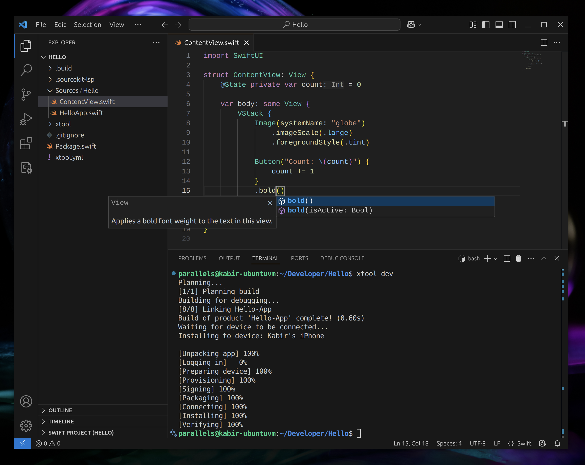

# xtool

Cross-platform Xcode replacement. Build and deploy iOS apps with SwiftPM on Linux, Windows, and macOS.

## Overview

xtool is a cross-platform (Linux/WSL/macOS) tool that replicates Xcode functionality with open standards.

✅ Build a SwiftPM package into an iOS app

✅ Sign and install iOS apps

✅ Interact with Apple Developer Services programmatically

## Getting Started

1. Follow the guide to install `xtool`
    - [Installation (Linux/Windows)](https://xtool.sh/documentation/xtooldocs/installation-linux)
    - [Installation (macOS)](https://xtool.sh/documentation/xtooldocs/installation-macos)
2. Create and run your first xtool-powered app by following the [tutorial](https://xtool.sh/tutorials/xtooldocs/first-app)!

## Examples

### Screenshot



### Command line interface

```bash
$ xtool --help
OVERVIEW: Cross-platform Xcode replacement

USAGE: xtool <subcommand>

OPTIONS:
  -h, --help              Show help information.

CONFIGURATION SUBCOMMANDS:
  setup                   Set up xtool for iOS development
  auth                    Manage Apple Developer Services authentication
  sdk                     Manage the Darwin Swift SDK

DEVELOPMENT SUBCOMMANDS:
  new                     Create a new xtool SwiftPM project
  dev                     Build and run an xtool SwiftPM project
  ds                      Interact with Apple Developer Services

DEVICE SUBCOMMANDS:
  devices                 List devices
  install                 Install an ipa file to your device
  uninstall               Uninstall an installed app
  launch                  Launch an installed app

  See 'xtool help <subcommand>' for detailed help.
```

### macOS development

For a version 2 project targeting `arm64-apple-macosx15.0`:

```sh
xtool dev build --configuration release --defer-signing
xtool dev verify xtool/MyApp.app
# On a Mac, build and run without adding signatures:
xtool dev run --configuration release -- --your-app-argument
# Or run an existing app, including one signed externally:
xtool dev run --app /path/to/MyApp.app -- --your-app-argument
```

The app runs in the foreground with terminal output and exit-status propagation. Ctrl-C
cancels the child process. Apps requiring entitlements or additional signing must be signed
first; the run command does not add signatures or install applications.

Copy the `.app`, `.artifact.json`, `.signing.json`, and `.signing-inputs/` together for a
portable handoff. `dev verify` checks the unchanged **pre-signing** bundle, resource files,
executable permissions, internal symlinks and entitlement inputs. Signing changes those bytes;
use `dev run --app` to launch an externally signed app without checking obsolete build hashes.
The inventory also records nested-code signing order and audits static Mach-O dependencies.
It detects changes, but does not authenticate who built the app or prove arbitrary `dlopen` paths.

Linux builds remain Release-only. A prepared SDK can be selected with `--swift-sdks-path`,
and `--scratch-path` selects a separate macOS build directory. macOS project generation
and provisioning remain separate work.

### macOS signing

Sign a verified build handoff on a Mac into a **new** output directory:

```sh
xtool dev sign xtool/MyApp.app --output signed --mode ad-hoc --dry-run
xtool dev sign xtool/MyApp.app --output signed --mode ad-hoc
xtool dev verify signed/MyApp.app --signed
# Certificate modes require an explicit certificate SHA-1 fingerprint:
xtool dev sign xtool/MyApp.app --output release-signed --mode developer-id --identity "$CERTIFICATE_SHA1"
```

`development` selects an Apple Development certificate; `developer-id` requires a
Developer ID Application certificate, hardened runtime and a secure timestamp. The signer
checks the actual certificate fingerprint and category. It does not select identities,
create certificates or provision capabilities. Provisioning-dependent entitlements are rejected.

Signing works on a private copy, applies each product's own entitlements in nested-code order,
and verifies signatures and effective entitlements before publishing. Input files remain unchanged;
existing output directories are rejected. The adjacent `.signing-receipt.json` records the original
artifact digest, signed inventory and verified signing metadata. Keep it with the signed app.
`dev verify --signed` checks that receipt and native signatures on a Mac. Inventories cover file
contents, executable bits and symlinks, not extended attributes, and are local integrity records
rather than authenticated build attestations. Old content-addressed entitlement inputs are retained
when replacing a build handoff so an interrupted update cannot delete the previous inputs.

### macOS notarization

Use the Developer ID signed output and an existing, explicitly selected `notarytool`
keychain profile. These commands run on a Mac:

```sh
xtool dev notarize submit release-signed/MyApp.app --output notarized --keychain-profile "$NOTARY_PROFILE"
xtool dev notarize resume notarized --keychain-profile "$NOTARY_PROFILE" --timeout 60
xtool dev notarize log notarized --keychain-profile "$NOTARY_PROFILE"
# Once accepted:
xtool dev notarize staple notarized
xtool dev notarize verify notarized
```

`status` queries without waiting. `submit` never reuses an existing output directory.
An interrupted submission with no recorded UUID remains uncertain: recover with
`resume --submission-id UUID` only when Apple's completed log matches the original upload
SHA-256. Status, resume and log never upload again. A wait timeout leaves the recorded attempt
available for later queries. Credentials are neither created nor selected automatically.

The release directory retains the original signed snapshot and upload ZIP, append-only receipt
files, and the Apple log binding acceptance to that exact archive. Stapling publishes a separate
`distribution/` containing the app, `distribution.zip` and a recovery receipt. Verification checks
that final inventory, archive hash, native signatures and stapled ticket. Interrupted distribution
publication can be resumed with `staple`. Preserve the complete directory for later verification.
These local receipts are not authenticated attestations or a guarantee of Gatekeeper approval.
The existing Fastlane release of xtool itself remains independent.

### Library

xtool includes a library that you can use to interact with Apple Developer Services, iOS devices, and more from your own app. You can use this by adding `XKit` as a SwiftPM dependency.

```swift
// package dependency:
.package(url: "https://github.com/xtool-org/xtool", .upToNextMinor(from: "1.2.0"))
// target dependency:
.product(name: "XKit", package: "xtool")
```
